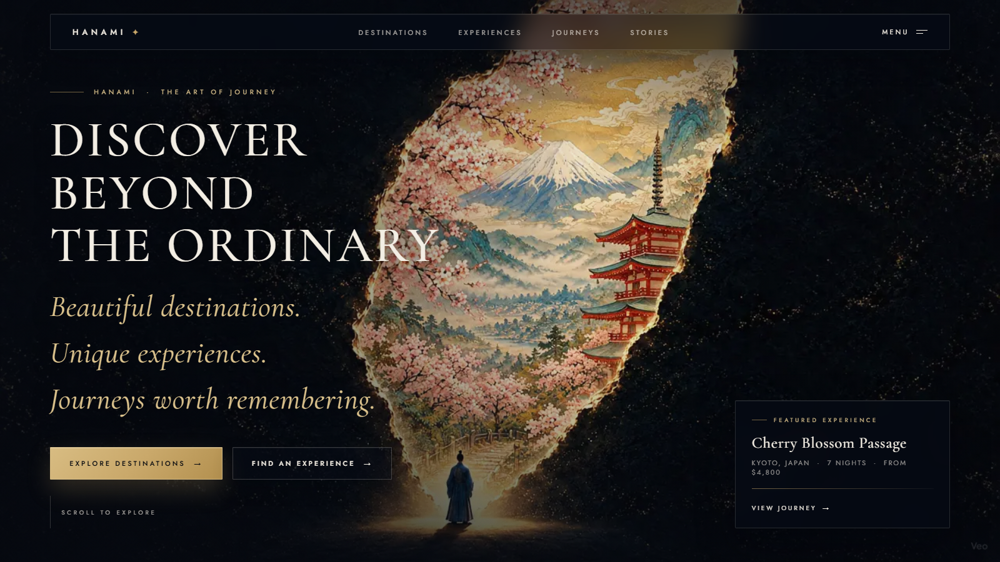

# HANAMI — Discover Beyond the Ordinary

<a href="https://wind-codes.github.io/hanami-web">
  
</a>

## ✨ Overview

HANAMI is a cinematic travel-discovery web experience built for **showcase and portfolio purposes**. It features a visually rich, animated hero section with a 192-frame parallax video, destination cards, unique experiences, and editorial stories — all in a single, self-contained HTML file with zero dependencies.

## 🎯 Tech Stack

| Layer | Tech |
|---|---|
| **Markup** | Semantic HTML5 |
| **Styling** | Pure CSS (CSS custom properties, grid, flexbox, `backdrop-filter`, animations) |
| **Animation** | Vanilla JavaScript (parallax, staggered reveals, frame-by-frame hero video) |
| **Assets** | WebP frames, JPG/WebP images |
| **Performance** | Lazy-loading images, `loading="lazy"`, async decoding |

## 🔧 Features

- **Hero section** — 192-frame sequence animation with parallax scrolling
- **Featured experiences** — interactive cards with glass-morphism overlays
- **Destination cards** — responsive grid with CSS-only hover effects
- **Stories section** — editorial layout with animated reveals
- **Responsive design** — mobile-first with media-query breakpoints
- **Accessibility** — semantic markup, `aria-labels`, focus-visible states

## 🚀 Deploy

The site deploys to any static host. For Netlify, just:

```bash
git clone https://github.com/wind-codes/hanami-web.git
cd hanami-web
netlify deploy --dir=.
```

Or connect the repo directly on [netlify.com](https://www.netlify.com).

## 📸 Preview


---

*Built as a portfolio piece by [wind-codes](https://github.com/wind-codes).